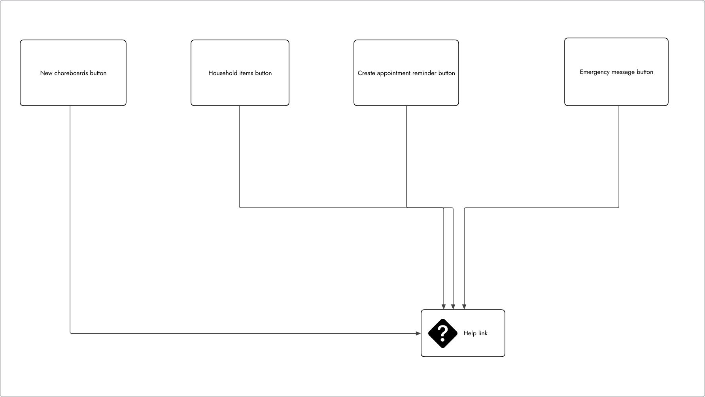
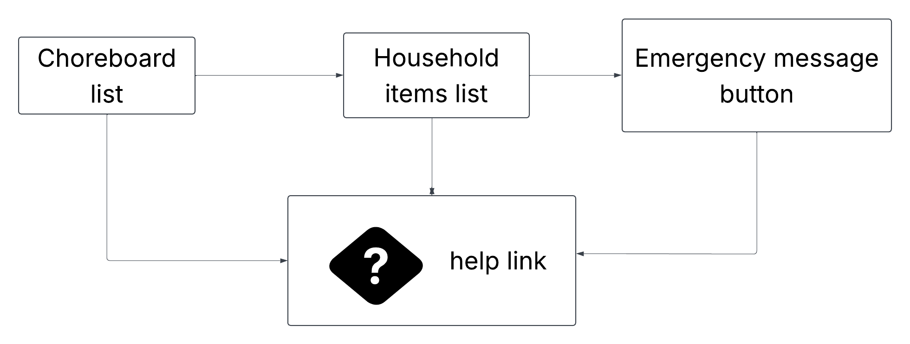

## Choreboards
Choreboards is a simple taskboard that has the aim of managing the household a little bit easier. Parents can delegate tasks to the children in the household while they are away. The main purpose of the application is to make the proccess of household chores more interactive and engaging. It is best described as a task board for household tasks that can be edited in real time to allow smooth task handling of the common and important tasks in a household.

## Project rationale:
- Why this application? 
Parents in a household are busy, and occasionally, tasks may slip through the mind which leads to a lot of stress. The "choreboard" as it is called, is a special kind of taskboard to take the stress out of planning household activities and put it into a single application that allows the members of the household to complete their tasks in an efficient manner. 
- how does it work? A member of the household logs in (usually a parent) and delegates the tasks to be done in the app. The choreboard can be edited to update the tasks to be done. Once the tasks are complete, the application prompts the users that the tasks have been complete.
- Philosophy behind the application:
Instead of a calendar, or using a notepad to list the tasks of the household, the process should be more interactive and engaging.
- The target audience:
Households(collectively), parents and their children. 
- How will it look like?
A single page with taskboards and labels on the taskboard to indicate the progress of a task. A page to sign up, a page to login to the application, a page that explains to the users the basic usage of the application (help page), and an about page.

## Features:
- A main content page containing the UX elements that shows up when the user logs in:
The interface elements that the user sees will depend upon the type of user being logged in. Users are divided into parents and children in the household. When the parent logs in, the parent sees an interface to create the list of tasks to do for the children, as well as edit the list and delete an item from the list as well. The second user type are the children in the household, provided that they are old enough to understand the use of a simple application. They are able to see the choreboards that have been created by the parent, and tick off each item in the choreboard and mark it as complete.
- The choreboard app also features an appointment reminder heading that pops out very boldly in terms of the color scheme and text to remind the members of the household about an important appointment.
- The right side of the application will have a section listing the items the household is running low on. 
- A bootstrap alert element that pops up on the bottom of the application main page to show an important message from the parent regarding an event or something that needs to be immediately communicated.
- A registration page for the parents of the household, where the parent (or parents) can also specify the name of their children that automatically creates a use-only account. A use only account can allow the children to work through the choreboard list, but not edit or delete the items.
- Parents as the users can create new taskboard lists called choreboards to delegate tasks to do for the household. Parents as users can also edit and delete the choreboard if required.
- Children as users of the apllication can tick through the choreboard and mark it as complete. They do not have create, update or delete permissions for the choreboard list. They have CRUD permissions to send an emergency message to the parent, and to create, read, update, and delete the items on the list of household items.

## UX flow of project:
The choreboards project uses a splendid approach to designing the user experience and information architecture called the Object Oriented User Experience(OOUX). OOUX helps to organize the user experience flow by lining up things with how the user would tend to think regarding the UX elements. This was made evident by reading the Source: 

Object Oriented User Experience (OOUX) is philosphical design model which respects the fact that people tend to model the world after objects. It simply makes sense of mess by prioritising user needs and business goals into a system of intereacting objects that is scalable and user-centered. The definition for this concept has been referenced from the source . The OOUX principle stems from the original ORCA(Objects -Relationships -CTAs -Attributes) process conceptualized in 2012 by Sophia Prater in her original article . 

The OOUX principle is based aorund the ORCA process, which is concerned with the following:
- Objects - The tangible things that remain in the user's mental model of the system.
- Relationships - How objects interconnect to each other and when.
- Calls-to-Action - What the user can do with the object.
- The content/metadata which builds object instances.

One important tidbit of the OOUX principle is that it is ineffective in deriving designs for pages that tend to be unique and require bespoke design like the landing page or the contact page as found in the source: . This means that the landing page and the contact page of choreboards is to have bespoke wireframes to lay out the design of the pages. It seems also, that the about page and the help page is of a similar structure which needs individual wireframe designs. The only page that consists of interactive objects therefore is the main content page where the user interacts with the taskboard. 

The main priciple of OOUX design is to lay out the interacting objects of the application and the value they have to the business before even drawing up a wireframe. So therefore, the core idea again, is to abstract away the complexity of the user interactions into simple objects that identify the action to be performed. 

As the main content page features different content being served depending on whether the user is a parent or a child of the household, the UX objects of the main content page have to be divided into two groups, which are parents and children.

### Choreboards UX objects for parents as users - 
The objects for the parent are outlined in the flow diagram below:

The diagram shows that the parent upon logging in to the application is exposed to four major objects, which are buttons that carry out a specific action. All of the buttons have a relationship with the help link object, as beside every button a help link element appears that has the sole purpose of taking the user to the help page, where the issue is explained in detail. 

- The new choreboard button performs the action of displaying an element containing an input element to take in the user input and create the element which has been termed as a "choreboard". The choreboard is a taskboard that allows the users to manage household tasks by marking them as complete to indicate a task being done. 

- The household items button performs the action of popping up a modal for the user that allows the user to input the items that the household is running low on. The action can be performed by both the parent and the children as users of the application. A child in the house for example, can help out by adding cling wrap to the list of household items needed. This can be seen by the parent too in the app main page. 

- The create appointment reminder button performs the action of sliding down a modal that allows the user to set a reminder for an important appointment. The modal is a custom modal that consists of the create appointment reminder form animated with jquery for the slide up and down effects and not a bootstrap modal. The create appointment reminder form allows the parent as a user to create a reminder for the entire household for an important appointment or event. In this way, at least one household member is aware of an important event or appointment.

- The emergency message button for the parent as a user allows the parent to quickly communicate to the household of a certain circumstance or event that is deemed as being important for the members of the household to know. The message is not saved to the database, but rather saved in memory as it is a temporary message for the household. The message takes into account each day the application is running. Therefore the message is removed on the next day to avoid user confusion. The help text on the help page explains this.

### Choreboards UX objects for children as users - 
The user objects for children as users are outlined in the diagram below:

The diagram shows that upon login, the children as users of the application will see the choreboards list, the household items list, and the emergency message button elements. And just like the parent UX objects, the children will also see a help link object that takes them to the help page. All of the objects have a relation with the help link object, as for each object there is a help link that aims to help the user understand the use of the feature. The children as users of the application can tick off each item in the choreboard and then press the complete button to mark the list as complete. When a choreboard list is complete, a bootastrap alert element pops up, informing the child of the task completion. Upon refreshing the page, the alert dissapears and a text shows up stating that there are no more tasks left to do. 

- The household items list allows the child to input the list of items that are running low in the household, so that they can be fetched later. The parent sees the list updated immediately when the child clicks on the submit button to submit the list. The items in the list can also be edited, or deleted by the child. 

- The emergency message button serves the purpose of letting the child send an emergency message to the parent in the case when something important needs to be communicated. For example, the child may be feeling quite ill and can send an emergency message to the parent asking him/her what to do in the case. The parent can then quickly guide the child. 

The appointment reminder is not exactly an UX object, but it also serves to remind someone in the household of something important upcoming as the element is always displayed in the main content page of the user.